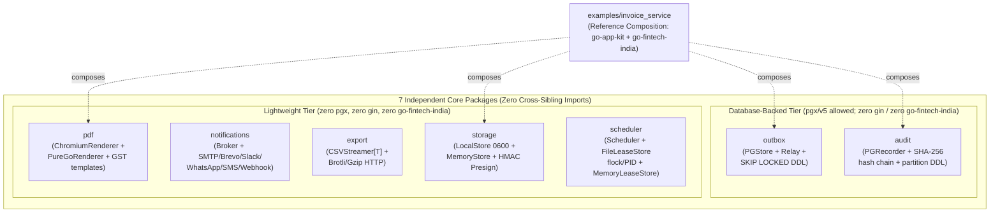

# System Architecture & Design Blueprint — `go-app-kit` (`v0.8.0`)

> **Step 2 of the Mandatory Grounding Order** (`AGENTS.md` -> **`docs/ARCHITECTURE.md`** -> `docs/FLOWS.md` -> `skills/*/SKILL.md` -> `docs/CODEGRAPH.md` -> targeted source reads only for verification).

This document defines the package boundaries, dependency isolation matrix, Ports & Adapters contracts, and lifecycle invariants of `github.com/abeta-dev/go-app-kit` (`v0.8.0`, Go `1.26.0`, `100.0%` statement coverage).

---

## 1. Architectural Philosophy

`go-app-kit` sits in the **Application Infrastructure Layer** above `github.com/abeta-dev/go-libs` and alongside `github.com/abeta-dev/go-fintech-india`:

- **7 Independent Workflow Packages, Zero Cross-Sibling Coupling**: None of the 7 core packages (`audit`, `export`, `notifications`, `outbox`, `pdf`, `scheduler`, `storage`) may import any other sibling package inside `go-app-kit`.
- **Strict Dependency Isolation**: Enforced on every PR by `./scripts/check_leaf_imports.sh` via `go list -deps` and isolated temporary consumer `go.mod` sandboxes.
- **Ports & Adapters**: Every external boundary (`outbox.Store`, `outbox.Publisher`, `audit.Recorder`, `pdf.Renderer`, `notifications.Sender`, `storage.Store`, `scheduler.LeaseStore`) is defined as a minimal Go interface with production and zero-dependency in-memory/local implementations.
- **No `replace` Directives**: `go.mod` always resolves published versions (`github.com/abeta-dev/go-libs v0.5.0`, `github.com/abeta-dev/go-fintech-india v0.4.0`); local multi-module work uses a caller-owned `go.work`.
- **Strict `N + 2` Deprecation Contract**: Legacy `pdf.WkhtmlRenderer` / `pdf.NewWkhtmlRenderer` are deprecated since `v0.8.0` and scheduled for removal in `>= v0.10.0` (verified by `./scripts/check_deprecation.sh` and [`docs/VERSIONING.md`](VERSIONING.md)).

---

## 2. Package & Dependency Isolation Topology

### Dependency Isolation Matrix (Enforced by `./scripts/check_leaf_imports.sh`)

| Package | Cross-Sibling Imports | `pgx/v5` | `gin` | `go-fintech-india` | Companion Skill |
| :--- | :---: | :---: | :---: | :---: | :--- |
| **`export`** | Forbidden | Forbidden | Forbidden | Forbidden | [`skills/go-app-kit-export/SKILL.md`](../skills/go-app-kit-export/SKILL.md) |
| **`pdf`** | Forbidden | Forbidden | Forbidden | Forbidden | [`skills/go-app-kit-pdf/SKILL.md`](../skills/go-app-kit-pdf/SKILL.md) |
| **`notifications`** | Forbidden | Forbidden | Forbidden | Forbidden | [`skills/go-app-kit-notifications/SKILL.md`](../skills/go-app-kit-notifications/SKILL.md) |
| **`storage`** | Forbidden | Forbidden | Forbidden | Forbidden | [`skills/go-app-kit-storage/SKILL.md`](../skills/go-app-kit-storage/SKILL.md) |
| **`scheduler`** | Forbidden | Forbidden | Forbidden | Forbidden | [`skills/go-app-kit-scheduler/SKILL.md`](../skills/go-app-kit-scheduler/SKILL.md) |
| **`audit`** | Forbidden | Allowed | Forbidden | Forbidden | [`skills/go-app-kit-audit/SKILL.md`](../skills/go-app-kit-audit/SKILL.md) |
| **`outbox`** | Forbidden | Allowed | Forbidden | Forbidden | [`skills/go-app-kit-outbox/SKILL.md`](../skills/go-app-kit-outbox/SKILL.md) |

---

## 3. Core Interface Contracts

| Package | Primary Port Interface | Built-In Adapters | Security / Reliability Invariant |
| :--- | :--- | :--- | :--- |
| **`outbox`** | `Store`, `Publisher`, `DBOperator` | `PGStore`, `Relay`, `PublisherFunc` | `SELECT ... FOR UPDATE SKIP LOCKED` + UUID `lease_token` fencing against stale workers. |
| **`audit`** | `Recorder`, `DBOperator` | `PGRecorder` | Tamper-evident SHA-256 hash chain (`ComputeHash`, `PrevHash`, `Hash`), JSON diffing (`ComputeDiff`), append-only trigger DDL. |
| **`pdf`** | `Renderer` | `ChromiumRenderer`, `PureGoRenderer`, legacy `WkhtmlRenderer` | Ephemeral loopback HTTP server for Chromium (SSRF isolation, no `file://` access), bounded concurrency semaphore, `html/template` auto-escaping. |
| **`notifications`** | `Sender` | `SMTPSender`, `BrevoSender`, `WhatsAppSender`, `SMSSender`, `SlackSender`, `WebhookSender` | Bounded workerpool `SendAsync`, constant-time HMAC-SHA256 `WebhookVerifier` with replay-window enforcement. |
| **`export`** | `Exporter[T]`, `Column[T]` | `CSVStreamer[T]`, `StreamHTTP[T]`, `StreamHTTPCompressed[T]` | Constant-memory streaming, Excel UTF-8 BOM, formula-injection escaping (`=,+,-,@,\t,\r`), RFC 9110 `Accept-Encoding` negotiation. |
| **`storage`** | `Store` | `LocalStore`, `MemoryStore` | Strict `ValidateKey` traversal blocking, atomic sibling temp + `0600` + `fsync` + `os.Rename` writes, constant-time HMAC-SHA256 `PresignGet` / `PresignPut` / `VerifyPresignedURL`. |
| **`scheduler`** | `LeaseStore` | `FileLeaseStore`, `MemoryLeaseStore` | Cross-process OS `flock` + `0600` PID-file lease fencing (`FileLeaseStore`), panic recovery barrier in `RunOnce`, graceful drain in `Start`. |

---

## 4. Schema & DDL Governance

PostgreSQL DDL migrations are versioned alongside their owning packages and verified by `./scripts/check_version.sh`:
- `audit/ddl/001_audit_logs.sql` — Range-partitioned append-only audit table with immutability trigger.
- `outbox/ddl/001_outbox_events.sql` — Outbox events state table (`pending`, `processing`, `published`, `dead_letter`).
- `outbox/ddl/002_outbox_concurrency_index.sql` — Partial covering index optimizing `SKIP LOCKED` batch polling.
- Detailed state-machine rationale: [`docs/adr/0001-outbox-leasing-state-machine.md`](adr/0001-outbox-leasing-state-machine.md).
