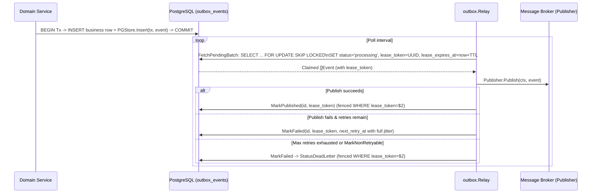
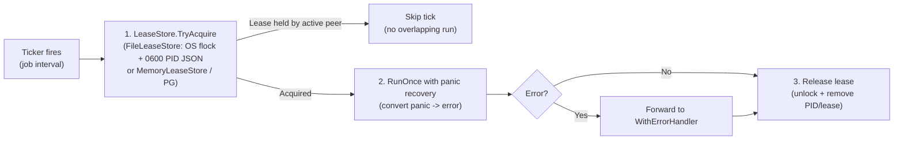

# End-to-End Execution Flows — `go-app-kit` (`v0.8.0`)

> **Step 3 of the Mandatory Grounding Order** (`AGENTS.md` -> `docs/ARCHITECTURE.md` -> **`docs/FLOWS.md`** -> `skills/*/SKILL.md` -> `docs/CODEGRAPH.md` -> targeted source reads only for verification).

This document traces the runtime flows across all 7 packages in `github.com/abeta-dev/go-app-kit` (`v0.8.0`, Go `1.26.0`) so agents understand concurrency, fencing, atomicity, and failure paths before reading source files.

---

## 1. Transactional Outbox & Lease-Fenced Relay (`outbox`)

- **Fencing guarantee**: If a worker stalls past `lease_expires_at` and a second worker reclaims the row with a new `lease_token`, the stale worker's `MarkPublished`/`MarkFailed` returns `ErrLeaseExpired` and cannot corrupt state.

---

## 2. HTML-to-PDF Rendering Flows (`pdf`)

### Path A: `ChromiumRenderer` (Rich CSS / `@page` Invoices)
1. Acquire bounded concurrency semaphore slot (respecting `ctx` cancellation).
2. Resolve Chrome/Chromium binary via configured path or `FindChromiumBinary()`.
3. Start an **ephemeral `127.0.0.1:0` loopback HTTP server** serving the rendered HTML string with a random single-use path token (SSRF isolation: avoids `file://` local disk reads and blocks untrusted relative file access).
4. Execute headless Chromium with `--print-to-pdf=<tmpfile>` pointing at the loopback URL under `ctx` timeout.
5. Read the generated PDF bytes into `*bytes.Buffer`, clean up the temp file, shut down the loopback server, and release the semaphore.

### Path B: `PureGoRenderer` (Zero External Binaries / Air-Gapped / Desktop)
1. Parse sanitized HTML block/heading/table structure into layout blocks in pure Go (`0` external processes).
2. Emit deterministic PDF 1.4 object streams, xref table, and trailer directly into `*bytes.Buffer`.

---

## 3. Atomic Local Object Storage & HMAC Presigned URLs (`storage`)

### `LocalStore.Put(ctx, key, r, meta)`
1. `ValidateKey(key)` rejects empty keys, `..`, leading/trailing `/`, backslashes, and null bytes.
2. Enforces optional max-object-size guard via `io.LimitReader`.
3. Creates parent directories (`0700`) and writes payload to a sibling temp file (`0600`) while computing the streaming SHA-256 digest.
4. Calls `fsync` on temp file, closes, and atomically swaps into place with `os.Rename`.
5. Atomically writes companion `.meta` JSON sidecar (content type, size, checksum, custom metadata) via the same temp+`0600`+rename sequence.

### Presigned URL Flow (`Store.PresignGet` / `Store.PresignPut`)
1. `PresignGet` / `PresignPut` signs `(method, key, expiresUnix)` using constant-time HMAC-SHA256 and returns a signed `PresignedURL`.
2. Inbound HTTP endpoint calls `VerifyPresignedURL(method, key, expires, sig, now)` before streaming directly from `Store.Get` / writing to `Store.Put`.

---

## 4. Local OS `flock` & Distributed Lease-Fenced Scheduling (`scheduler`)

- **`FileLeaseStore` crash recovery**: Holds an OS-level advisory lock (`flock` on Unix) over `<dir>/<job>.lock` alongside a `0600` JSON lease file containing `{holder_id, pid, expires_at}`. If a process crashes (`SIGKILL`), the OS automatically releases the `flock` and expired/dead-PID leases are reclaimed cleanly by the next process.
- **Graceful shutdown**: Canceling `ctx` passed to `Scheduler.Start(ctx)` stops new ticks and waits for all in-flight jobs to drain before returning.

---

## 5. Multi-Channel Notifications (`notifications`)

1. `Broker.RegisterSender(sender)` binds channel implementations (`Email`, `Brevo`, `WhatsApp`, `SMS`, `Slack`, `Webhook`).
2. `Broker.Send(ctx, msg)` dispatches synchronously to the registered channel sender.
3. `Broker.SendAsync(ctx, msg)` submits work to a bounded internal workerpool; `Broker.Close()` drains queued notifications cleanly.
4. Outbound webhooks sign `timestamp.payload` with HMAC-SHA256; receivers verify via `WebhookVerifier.Verify` (constant-time signature + configurable replay window).

---

## 6. Hash-Chained Compliance Audit Trail (`audit`)

1. Domain service constructs `audit.NewEvent(actor, action, entityType, entityID)`.
2. `ComputeDiff(beforeJSON, afterJSON)` generates a structured field-level change map.
3. `ComputeHash(prevHash, event)` links the entry into a tamper-evident SHA-256 chain.
4. `PGRecorder.Record(ctx, event)` (or `RecordAsync`) inserts into the monthly range-partitioned `audit_logs` table protected by PostgreSQL's append-only trigger (`001_audit_logs.sql`).

---

## 7. Constant-Memory Streaming Compressed CSV Export (`export`)

1. `StreamHTTPCompressed[T]` inspects `Accept-Encoding` via `NegotiateEncoding` (RFC 9110 q-values: `br` -> `gzip` -> identity) and borrows a pooled encoder writer.
2. Sanitizes `Content-Disposition` filename and optionally emits UTF-8 BOM for Excel compatibility.
3. `CSVStreamer[T]` reads rows lazily from the caller's iterator/cursor, escapes spreadsheet formula prefixes (`=`, `+`, `-`, `@`, `\t`, `\r`), flushes in constant-memory batches, and returns encoder buffers to pools on close.
